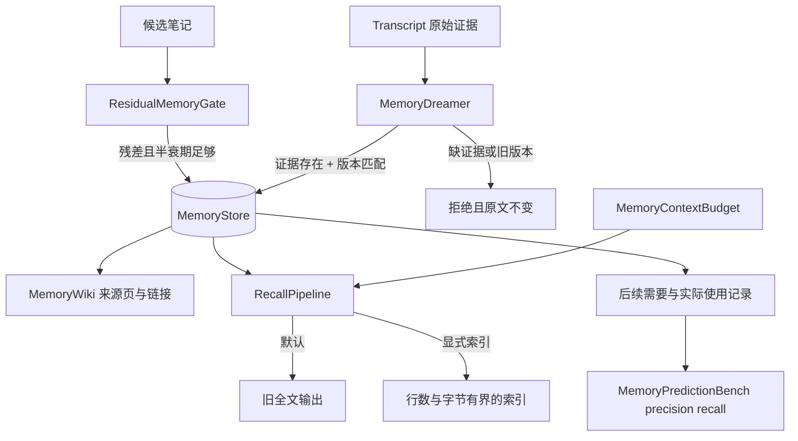
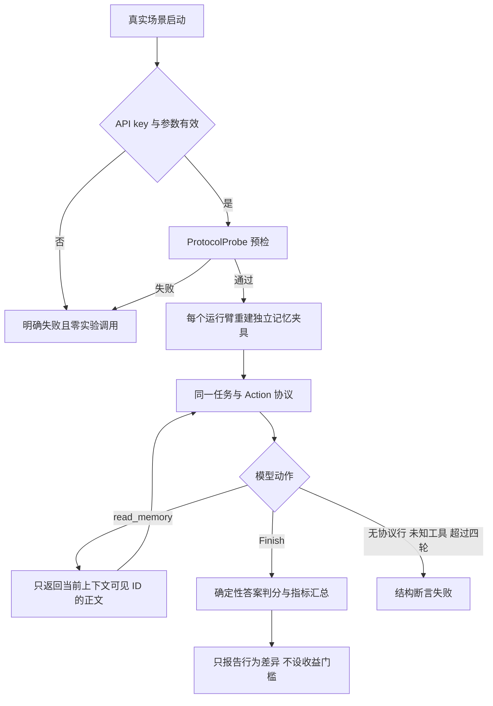

# Agent Memory Dreaming - Plan

## Goal Capsule

- **Objective:** 长期记忆只保留未来可能复用且无法从环境直接重读的经验，离线整理能依据原始记录纠错，共享写不会静默覆盖，顶层注入和实际复用都有可检查的边界与指标；真实模型对照让使用者看到这些机制在同一批任务上的实际表现及样本限制。
- **Means:** 扩展现有 `harness.memory` 的知识状态、版本、写入闸门、Dreaming、注入预算和预测评价，不另建平行记忆库（KTD1、KTD2、KTD3、KTD4）；真实组复用同一记忆链，以同题 A/B、确定性判分和分片运行比较无记忆、未治理与治理后注入（KTD6、KTD7、KTD8、KTD9）。
- **Authority:** 以三篇知乎文章及其共同引用的 Anthropic 原文为能力来源，以当前仓库兼容性、真实协议预检与构建规则为工程约束。
- **Execution profile:** 一次交付，原五个离线单元已完成，追加三个真实对照单元；不提交、不推送。
- **Stop conditions:** 旧场景行为必须改变才能通过、无法保留旧构造兼容、验证暴露共享写数据损坏、或真实协议预检失败时，停止并重新评估设计。
- **Finishes and ships:** 当前实现者完成代码、剧本、真实对照、文档和本地回归；最终交付由仓库所有者决定。

---

## Product Contract

### Summary

在现有“召回—写回—遗忘—五维评测”之后补上 Dreaming 控制面。新能力用剧本证明：状态型记忆被拦、日志有反证才可纠错、过期版本不能覆盖、顶层只带有限索引、Wiki 链接可修复、记忆写入能按未来使用计算 precision/recall。追加的真实对照用同题 A/B 报告这些机制对模型回答和上下文成本的实际影响。

Product Contract preservation：changed: R10—R13 与真实对照范围——用户明确批准在离线闭环后追加真实模型对照。

### Problem Frame

当前 `Memory` 有来源、置信度和生命周期，但无法区分观察、推断、验证与失效知识；`MemoryStore` 的多步读写没有版本检查，两个整理者可能拿同一旧值互相覆盖。召回上下文只有条数限制，没有字节预算或索引模式。现有五维 benchmark 能证明“存了找得到”，不能证明“写下的内容后来被需要并使用”。

三篇文章共同指出：记忆的写入是对未来需求的预测，Dreaming 是离线整理而非天然正确的知识生成器。落地必须保留原始证据、可撤销性和成本边界，不能只增加文件数量。已有 `MemoryRealScenario` 只校验真实输出接入后机制仍然成立，没有无记忆或未治理记忆的对照，不能据此判断任务收益。

### Requirements

**写入与版本**

- R1. 记忆必须区分 `OBSERVED`、`INFERRED`、`VERIFIED`、`STALE` 知识状态，并保留现有生命周期状态与来源。
- R2. 可重新观测的当前状态，以及半衰期短于维护周期的候选，不得进入长期记忆；拒绝原因必须可读。
- R3. 每次记忆变更必须递增版本；携带旧版本的纠错或确认必须失败，且内容保持不变。

**Dreaming 与表示**

- R4. 纠错和低置信记忆转正必须同时提供原始 transcript 中真实存在的证据与当前版本，缺证据或证据不在日志中都不得写入。
- R5. Dreaming 必须覆盖创建笔记、纠错、构建表示、上提、聚焦与断链修复；原始 transcript 仍是证据层，Wiki 不替代检索。
- R6. Wiki 页面必须引用来源记忆，总字节数不得超过原始语料的配置比例；断链只能重定向到已存在页面。

**注入与评价**

- R7. 顶层注入必须支持只含记忆标识、标签、来源、知识状态和版本的索引模式，并同时受行数与 UTF-8 字节预算约束。
- R8. 记忆预测评价必须按写入集合、后续需要集合、后续实际使用集合计算 precision 与 recall，空集合返回可解释结果。
- R9. 现有构造、默认召回输出和既有场景保持兼容，新能力只能通过显式调用启用。

**真实模型对照**

- R10. 纠错与遗忘任务必须比较无记忆、未治理记忆和治理后记忆三组，预算任务必须比较全文与有界索引两组；同题各组使用相同任务文本、协议和重复次数。
- R11. 判分必须由期望标识、禁用标识和拒答标记确定性完成；答对、含禁用值、拒答和其他错误分别计数，无记忆组的拒答不得算答对。
- R12. 真实实验必须先过 `ProtocolProbe`，按纠错、遗忘、预算三个分片运行，每组默认重复 3 遍并记录模型、原始动作、调用数、初始记忆上下文 UTF-8 字节和累计请求 UTF-8 字节。
- R13. 行为结果只报告不充当退出门槛；缺 key、探针失败、非法参数、未按协议收口、未知工具或轮数耗尽必须明确失败，且不得悄悄退回剧本。

### Success Criteria

- 新 JUnit 覆盖 R1—R8 与确定性判分的正常、边界和失败路径，并在功能实现前能看到相关测试失败。
- 新剧本 `@memorydream` 将五类行为串成一条离线整理流程，所有断言通过。
- 新真实场景 `@memorydreamreal` 三个分片均完成结构断言并留下实际对照数据；正确率提升或字节下降不是预设通过条件。
- 研读文档记录每组的样本量、分子分母、调用与字节指标，明确单模型小样本不能推出统计显著或跨模型结论。
- `@memory`、`@memorysystem`、`@memorybench`、`@loopbench` 与全量 `mvn -q clean verify` 保持通过。

### Scope Boundaries

- 不做模型权重更新、参数化知识或强化学习。
- 不实现通用自然语言矛盾识别；Dreamer 接收结构化证据，并验证它确实存在于 transcript。
- 不引入向量数据库、外部 Wiki 服务或新生产依赖。
- 真实对照只做当前配置模型的探索性小样本实验，不做多模型横评、显著性检验或普遍收益承诺。
- 不把既有五维 benchmark 改成任务收益证明；新增预测指标与真实任务判分分别呈现。
- 不改动原五幕离线行为，不顺手重构既有真实场景；若发现独立缺陷，记录后另行处理。

---

## Planning Contract

### Key Technical Decisions

- KTD1. **扩展 `Memory` 而不是新建第二套记录。** 增加知识状态与版本字段，保留旧参数列表的委托构造；来源继续承担证据定位，避免平行模型漂移。
- KTD2. **在 `MemoryStore` 内做原子版本检查。** 读写方法同步，纠错与确认接收期望版本；比在外部加锁更直接地保护实际数据。
- KTD3. **Dreamer 只做受控更新。** `MemoryTranscript` 提供证据存在性检查，`ResidualMemoryGate` 管写入，`MemoryWiki` 管表示，`MemoryContextBudget` 管聚焦；Dreamer 组合它们而不假装通用推理。
- KTD4. **预算功能以可选策略接入 `RecallPipeline`。** 默认无界全文模式保持旧行为，显式索引模式才输出指针并截断。
- KTD5. **预测评价使用聚合计数。** precision 是写入后实际使用比例，recall 是后续需要项中当时已写入比例；非法的使用集合直接拒绝，避免指标看似合理但口径失真。
- KTD6. **真实收益用同题 A/B，不用结构冒烟代替。** 无记忆、未治理与治理后组只在记忆准备和注入表示上不同，任务与 Action 协议保持一致。(session-settled: user-approved — chosen over 只校验真实输出接入机制：用户明确批准追加实际对照实验，Governs R10、R11、R12、R13)
- KTD7. **每个运行臂使用独立夹具和独立调用计数。** 真实请求无共享会话状态，单臂最多 4 轮，只有 `Finish` 能进入答案判分；自然语言闲聊、未知工具和轮数耗尽都是装置失败。
- KTD8. **答案判分与实验退出码分离。** `MemoryAnswerBench` 用期望、禁用和拒答标记分类输出，结构断言只保证实验有效，不要求任何臂必须答对或节省字节。
- KTD9. **预算组同时报上下文体量与真实请求代价。** 全文臂直接看到正文，索引臂只能通过 `read_memory` 读取当前索引中的 ID；初始记忆字节与含后续轮次的累计请求字节分别统计，避免把少注入直接等同于总成本必然下降。

### High-Level Technical Design

| 实验 | 对照臂 | 相同条件 | 报告指标 |
|---|---|---|---|
| 纠错 | 无记忆 / 旧版本全文 / 证据纠错后全文 | 虚构项目标识、问题、协议、3 遍 | 当前值答对、旧值污染、拒答、调用与字节 |
| 遗忘 | 无记忆 / 过期与有效全文 / 清理后全文 | 过期与当前时间、问题、协议、3 遍 | 当前时间答对、过期时间污染、拒答、调用与字节 |
| 预算 | 全部正文 / 三条索引按需读取 | 同一记忆库、目标标识、协议、3 遍 | 答对、索引读取、初始记忆字节、累计请求字节、调用 |

### Assumptions

- 用户只提供链接，按仓库约定理解为执行完整研读闭环，而非只做摘要；随后明确批准追加真实模型对照。
- 默认旧场景不改为索引模式，因为既有场景断言依赖正文出现在注入块中。
- 版本从 `0` 开始，任何成功变更递增 `1`；纯读取不递增。
- Wiki 压缩比是明确配置的防膨胀上限，不声称存在适用于所有语料的最佳比例。
- precision/recall 的后续需要集合来自任务或评测标注，不由模型自报。
- 每组默认 3 遍只用于暴露当前模型的小样本行为，不用于显著性检验；真实客户端未暴露可控随机种子，重复结果不声称独立同分布。
- 测试事实采用虚构项目和任意标识，期望与禁用值使用完整字符串匹配，降低常识猜测和子串误判。
- 预算夹具的目标记忆必须进入索引；若未进入导致无法回答，记为行为结果，不改夹具追求好看数字。

### System-Wide Impact

- `Memory` 是 core 的公开值对象，必须保留旧构造兼容。
- `MemoryStore` 的同步范围会影响所有写入与检索，更新函数必须短且不得调用外部服务。
- `RecallPipeline` 的新构造只增加可选策略，既有 `MemoryMetrics` 统计最终实际注入条数。
- 新场景只依赖 core，验证模块不反向进入 core；真实网络调用只留在 verify wiring，core 的判分器保持纯逻辑。
- 真实对照会产生外部模型调用与费用，只在新场景显式运行时发生，离线构建和原剧本不触发网络。

### Risks & Dependencies

- **风险：** 旧构造推断出的知识状态可能过强。处理：旧构造仅按原置信度与生命周期做保守映射，新写入可显式声明状态。
- **风险：** 同步 `MemoryStore` 在竞争激烈时降低吞吐。处理：本轮优先正确性，锁内只做内存操作；并发性能不属于本轮优化目标。
- **风险：** 字节截断可能切断多字节字符。处理：按完整字符串逐行纳入，不对单行做字节级硬切；超长单行整行省略并计数。
- **风险：** Wiki 比例限制可能拒绝合法扩展。处理：返回明确拒绝原因，由调用方调整来源规模或配置，不静默放宽。
- **风险：** 小样本波动可能掩盖或夸大收益。处理：公开每臂分子分母和原始动作，不做显著性或跨模型外推。
- **风险：** 索引臂额外读取可能使累计请求字节反超全文臂。处理：分别报告初始与累计字节，不把节省上下文预设为实验成功。
- **风险：** 真实模型输出漂移可能被误判为答案质量。处理：协议错误进入结构失败，只有合法 `Finish` 才进入行为判分；瞬时网络故障沿用 `RetryingLlm`。

---

## Implementation Units

### U1. 知识状态、残差写入与版本保护

- **Goal:** 让记忆可区分知识状态，拒绝可重观测状态，并阻止旧版本覆盖。
- **Requirements:** R1、R2、R3、R9。
- **Dependencies:** 无。
- **Files:** `core/src/main/java/com/example/harness/memory/Memory.java`、`core/src/main/java/com/example/harness/memory/MemoryStore.java`、`core/src/main/java/com/example/harness/memory/ResidualMemoryGate.java`、`core/src/test/java/com/example/harness/memory/ResidualMemoryGateTest.java`、`core/src/test/java/com/example/harness/memory/MemoryStoreRevisionTest.java`。
- **Approach:** 保留旧构造委托；新增显式知识状态写入；所有状态与内容变化递增版本；纠错和确认提供带期望版本的原子路径。
- **Execution note:** 先写版本冲突与残差过滤的失败测试，再实现最小行为。
- **Patterns to follow:** 现有 `Memory` record 值对象与 `MemoryStore` 的写回方法。
- **Test scenarios:**
  - 可重观测的“当前金币 30”被拒绝，不可重观测且验证过的“连续三次失败后调整节奏”写入成功。
  - 半衰期低于维护周期的候选被拒绝，边界值等于维护周期时允许。
  - 两个读取到版本 0 的整理者先后纠错，首个成功且版本变 1，第二个失败且首个新内容不变。
  - 旧构造生成的对象字段与原默认值一致，新增字段采用保守默认。
- **Verification:** 新测试通过，既有 memory 剧本无需修改仍通过。

### U2. 有证据的 Dreaming 与 Wiki 表示

- **Goal:** 把离线整理做成可审计的受控更新，并覆盖表示构建与断链修复。
- **Requirements:** R4、R5、R6。
- **Dependencies:** U1。
- **Files:** `core/src/main/java/com/example/harness/memory/MemoryTranscript.java`、`core/src/main/java/com/example/harness/memory/MemoryWiki.java`、`core/src/main/java/com/example/harness/memory/MemoryDreamer.java`、`core/src/test/java/com/example/harness/memory/MemoryDreamerTest.java`、`core/src/test/java/com/example/harness/memory/MemoryWikiTest.java`。
- **Approach:** transcript 只负责证据定位；Dreamer 组合纠错、笔记、表示、上提与断链修复；Wiki 对来源、总字节和链接目标做确定性校验。
- **Patterns to follow:** `MemoryJanitor` 的报告型返回与 `MemoryConsolidator` 的决定留痕。
- **Test scenarios:**
  - 日志包含“出口在东侧”的反证时纠错成功并转为 `VERIFIED`，相同文本不在日志时拒绝。
  - 低置信记忆有证据可上提，无证据或旧版本时保持 `UNCONFIRMED`。
  - 一页引用两个来源记忆且体积未超限时建立成功，无来源或超压缩比时拒绝。
  - 缺页链接先进入审计清单，重定向到已存在索引页后清除，指向不存在页时拒绝。
- **Verification:** 所有拒绝路径都断言原数据未变化，成功路径断言来源与版本可追踪。

### U3. 顶层索引与注入预算

- **Goal:** 让显式顶层注入只带有界索引，不夹带正文，也不超行数或字节数。
- **Requirements:** R7、R9。
- **Dependencies:** U1。
- **Files:** `core/src/main/java/com/example/harness/memory/MemoryContextBudget.java`、`core/src/main/java/com/example/harness/memory/RecallPipeline.java`、`core/src/test/java/com/example/harness/memory/MemoryContextBudgetTest.java`。
- **Approach:** 新增可选预算策略与索引行渲染；最终行集合逐行计算 UTF-8 字节，省略项写入 notes；默认策略保持现有全文输出。
- **Test scenarios:**
  - 索引模式不包含记忆正文，但包含 ID、标签、来源、知识状态与版本。
  - 两行预算面对三条记忆时只注入两行，notes 记录省略一条。
  - 中文内容按 UTF-8 字节计量，下一行会超预算时整行省略。
  - 单行自身超预算时不产生半个字符，返回空注入与省略统计。
  - 默认构造的旧全文行保持原格式。
- **Verification:** 预算测试与既有召回场景共同通过。

### U4. 记忆预测 precision/recall

- **Goal:** 用后续实际需要与使用评价写入判断，而不是用文件数量替代收益。
- **Requirements:** R8。
- **Dependencies:** 无。
- **Files:** `core/src/main/java/com/example/harness/memory/MemoryPredictionBench.java`、`core/src/test/java/com/example/harness/memory/MemoryPredictionBenchTest.java`。
- **Approach:** 以会话为输入单元，校验使用集合属于写入集合且需要集合包含使用集合，再聚合计算两项指标。
- **Test scenarios:**
  - 写入两条、后续实际使用一条时 precision 为 1/2；后续需要两条、当时写入其中一条时 recall 为 1/2。
  - 多会话按总数聚合，不对空会话做除零。
  - 无写入时 precision 返回 `NaN`，无后续需要时 recall 返回 `NaN`，调用方可区分“不适用”与零分。
  - 使用未写入或未被需要的 ID 时抛出参数异常，不产出伪指标。
- **Verification:** 分数、边界和非法输入均有精确断言。

### U5. 剧本、研读存档与运行登记

- **Goal:** 用一条离线剧本展示全部能力，并留下文章浓缩、运行入口与验证结果。
- **Requirements:** R1—R9。
- **Dependencies:** U1、U2、U3、U4。
- **Files:** `verify/src/main/java/com/example/harness/memory/MemoryDreamingScenario.java`、`verify/pom.xml`、`docs/anthropic_agent_memory.md`、`LANGGRAPH4J.md`。
- **Approach:** 剧本分五幕覆盖残差写入、证据纠错与版本冲突、Wiki 与断链、索引预算、预测评分；文档区分文章事实、作者评论与本仓库落地，不引用证据不足的收益数字作为结论。
- **Test scenarios:**
  - `@memorydream` 五幕均打印实际决定并返回总断言成功。
  - pom 的 mainClass 指向新场景，LANGGRAPH4J 记忆章节有对应运行行与能力说明。
  - 浓缩档开头列出三篇知乎链接与 Anthropic 原文链接，记录跨模型比较、题量与成本未归一等证据边界。
- **Verification:** 新场景、既有 memory 场景、loopbench 与全量构建全部通过，文档入口可执行。

### U6. 确定性答案判分器

- **Goal:** 把真实模型终答分成答对、含禁用值、拒答和其他错误，保证各臂按同一口径计数。
- **Requirements:** R10、R11。
- **Dependencies:** 无。
- **Files:** `core/src/main/java/com/example/harness/memory/MemoryAnswerBench.java`、`core/src/test/java/com/example/harness/memory/MemoryAnswerBenchTest.java`。
- **Approach:** 判分器只接收终答与任务标注，不读取模型自评；禁用值优先判为污染，只有不含禁用值且命中完整期望标识才算答对，拒答单独归类。
- **Execution note:** 先用错误答案、新旧值同时出现和无记忆拒答写失败测试，再实现最小判分逻辑。
- **Patterns to follow:** `MemoryPredictionBench` 的纯逻辑输入校验与可核对结果。
- **Test scenarios:**
  - 终答含 `EAST-42` 且不含 `NORTH-17` 时判为答对。
  - 终答只含旧值，或同时含新旧值时均判为含禁用值，不得计答对。
  - 不含任何标识但含“无法确定”或“不知道”时判为拒答，不计答对。
  - 空答案、无关答案和只有期望标识子串时判为其他错误。
- **Verification:** 新增 JUnit 全绿，判分不依赖真实模型或 verify 类。

### U7. 真实 A/B 场景与运行登记

- **Goal:** 用同一 Action 协议跑纠错、遗忘和预算三组真实对照，并保证装置失败与行为低分分开。
- **Requirements:** R9、R10、R11、R12、R13。
- **Dependencies:** U1、U2、U3、U6。
- **Files:** `verify/src/main/java/com/example/harness/memory/MemoryDreamingRealScenario.java`、`verify/pom.xml`、`core/src/test/java/com/example/harness/memory/MemoryAnswerBenchTest.java`、`LANGGRAPH4J.md`、`README.md`、`AGENTS.md`。
- **Approach:** 主入口统一做配置与参数校验、`ProtocolProbe` 和分片选择；每臂独立构造记忆库，以最多 4 轮的 `read_memory` / `Finish` 循环收集终答，包装真实客户端统计调用和请求字节，按 KTD6—KTD9 输出每臂明细与汇总。
- **Execution note:** 先完成离线编译和判分回归，再逐片真实运行；任一探针或结构断言失败先修装置，不继续烧后续调用。
- **Patterns to follow:** `RealFoldEvalScenario` 的行为报告与结构断言分工、`MemoryRealScenario` 的记忆夹具、`ProtocolProbe` 的硬预检。
- **Test scenarios:**
  - 纠错分片对无记忆、旧版本和证据纠错后三组各跑指定遍数，只有治理组使用 transcript 中的新证据推进版本，汇总当前值、旧值和拒答计数。
  - 遗忘分片的未治理组同时看到过期与当前时间，治理组经 `MemoryJanitor` 清理后只看到当前时间，无记忆组没有项目事实。
  - 预算分片的全文组看到全部正文，索引组只看到三条索引；`read_memory` 只能读取当前上下文列出的 ID，正确读取后追加正文观察。
  - 无协议行、未知工具、读取不可见 ID 后超过 4 轮、或未 `Finish` 收口均使结构断言失败，不进入答案判分。
  - 缺 key、非法分片号和非正数重复次数在实验调用前明确失败；探针失败时后续实验调用数为零。
  - 每片打印模型名、每遍原始动作、调用数、初始记忆 UTF-8 字节和累计请求 UTF-8 字节，场景数为 70 的登记保持一致。
- **Verification:** `memorydreamreal` 三个分片各自完成结构断言；行为分数可以是任意真实结果，但明细与汇总必须可核对。

### U8. 真实结果留档与证据边界

- **Goal:** 将本次真实运行的实际数字和限制写回研读文档，避免结果只留在终端或计划里。
- **Requirements:** R12、R13。
- **Dependencies:** U7。
- **Files:** `docs/anthropic_agent_memory.md`、`LANGGRAPH4J.md`。
- **Approach:** 保存三片控制台日志作临时核对材料，在正式文档中记录运行日期、模型、每臂样本量、分类计数、调用与字节指标，结论只覆盖本次观察。
- **Test scenarios:**
  - 文档中的每个比例都能由对应分子分母复算，预算均值注明算术平均口径。
  - 任一臂未答对或累计字节未下降也照实记录，不改写成机制普遍有效。
  - 运行入口、结果摘要和限制从记忆章节可达，临时日志与实验残留不作为交付物。
- **Verification:** 文档数字与三片真实输出一致，明确单模型、小样本、无随机种子控制三项限制。

---

## Verification Contract

| Gate | Command | Done signal |
|---|---|---|
| 单元测试 | `mvn -q test -pl core` | 新增与既有 JUnit 全绿 |
| 原离线剧本 | `scripts/dev.sh memorydream` | 五幕断言全绿，失败路径原文不变 |
| 真实纠错分片 | `scripts/dev.sh memorydreamreal "1 3"` | 三组各 3 遍完成结构断言并输出分类与成本明细 |
| 真实遗忘分片 | `scripts/dev.sh memorydreamreal "2 3"` | 三组各 3 遍完成结构断言并输出分类与成本明细 |
| 真实预算分片 | `scripts/dev.sh memorydreamreal "3 3"` | 两组各 3 遍完成结构断言并输出读取与字节明细 |
| 旧记忆回归 | `scripts/dev.sh memory && scripts/dev.sh memorysystem && scripts/dev.sh memorybench` | 旧输出与断言保持通过 |
| 基础基准 | `scripts/dev.sh loopbench` | 图版与原语版仍为 2 轮 / 4 次调用打平 |
| 收尾底线 | `mvn -q clean verify` | 两模块构建、全部单测与集成验证通过 |
| 依赖边界 | 编译期检查 | core 不引用 verify 类，`-Werror -Xlint:all` 无警告 |

## Definition of Done

- R1—R13 均有代码与至少一个直接测试、剧本断言或真实结构断言。
- 旧公开构造、默认召回和原五幕行为未破坏，未引入新生产依赖或环境变量。
- 三篇文章浓缩存档、Anthropic 原文出处、机制映射、真实对照结果与证据限制均已写入 `docs/anthropic_agent_memory.md`。
- 新真实场景已登记 `verify/pom.xml` 和 `LANGGRAPH4J.md`，README、AGENTS 与运行章节的场景数统一为 70。
- Verification Contract 所有门均实际运行并记录结果；没有失败的测试、未解决的编译警告、临时实验代码或把行为收益当结构门槛的断言。
