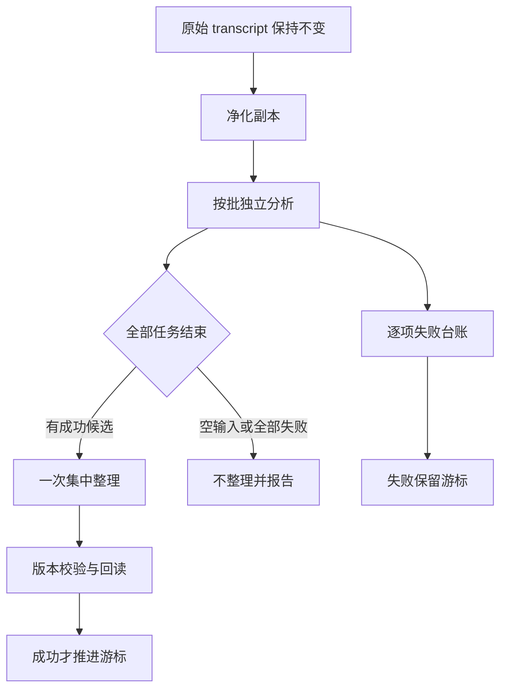
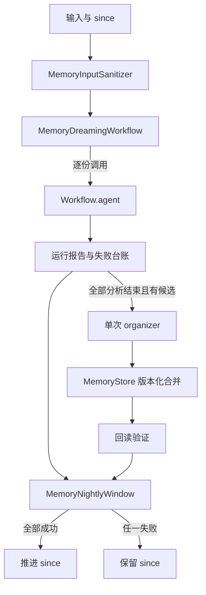

# 动态记忆整理 - Plan

## Goal Capsule

- **Objective:** 多份会话整理后，操作者能核对每份输入的处理结果；并发写不会静默丢事实，失败窗口能在下一轮重试，消费记忆的会话不能修改记忆。
- **Means:** 在现有记忆、工作流和安全边界上增加动态整理流程，不接入外部托管服务。
- **Product authority:** 本计划只覆盖离线可验证的整理机制和小样本真实对照。
- **Open blockers:** 无。
- **Execution profile:** 一个改动组，由当前会话完成实现与验证；是否提交、推送由用户另行决定。
- **Stop conditions:** 协议探针失败则停止真实调用；发现需要改变既有 Dreaming 行为或新增外部服务时停止扩展。

## Product Contract

### Summary

新增按批分析、一次集中整理和运行对账，配套版本化合并、输入净化、只读消费与增量窗口。保留上一轮单会话 Dreaming 行为。

### Problem Frame

当前实现一次只处理一份 transcript，无法说明多份输入中哪份失败，也没有集中整理前的完成屏障。共享整理若没有版本检查，后写者可能覆盖先写者；失败若推进游标，下一晚会永远跳过未处理输入。原始 transcript、记忆内容和运行结果都可能夹带指令，不能直接当作系统指令执行。

### Key Decisions

- **复用现有工作流与安全组件。** 不新增通用编排、密钥识别或注入检测框架。Governs R1, R5, R6
- **完整性优先于尽力成功。** 输入失败会出现在报告中，不能算作已处理。Governs R2, R3
- **真实模型只回答行为差异。** 小样本不设效果或成本门槛，不把 Anthropic 示例成本写成本仓库收益。Governs R9

### Actors

- A1. 每份 transcript 的独立分析者，只读单份净化副本并产出候选操作。
- A2. 集中整理者，在全部分析者结束后处理候选操作。
- A3. 消费会话，只读使用整理后的记忆。
- A4. 夜间窗口调用者，显式提供游标并接收本轮对账。

### Requirements

**编排与对账**

- R1. 输入按可配置批次处理，每份 transcript 有独立分析任务，所有分析任务已结束后集中整理最多执行一次。
- R2. 报告记录预期输入数、成功分析数、逐项失败原因、是否执行集中整理和批次数。
- R3. 单个分析失败不取消其他输入；空输入不执行集中整理，集中整理失败必须可见且不能报告成功。
- R4. 集中整理支持去重、完整索引、移动存根和无法判定的冲突保留，不得猜测冲突答案。

**写入与安全**

- R5. 共享合并在写前校验版本，冲突方重读当前版本后合并双方新增事实，并在写后回读验证。
- R6. 原始证据保持不变，分析只使用经过现有注入与已登记密钥处理的副本；密钥不得写入整理结果。
- R7. 消费会话复用现有只读工具策略，允许读取、拒绝写入并留下拒绝记录。

**增量与验证**

- R8. 只有本轮成功才推进增量游标；失败保留原窗口，运行中的会话不进入本轮，也不会被后续窗口自动补抓。
- R9. 离线场景覆盖上述行为；真实协议可靠时才运行小样本“单次共享整理 vs 独立分析加集中整理”同题对照，记录事实保留、旧值污染、调用数和请求字节。

### Key Flows

- F1. 分批整理
  - **Trigger:** A4 提交多份已结束 transcript。
  - **Steps:** 净化输入；按批调用 A1；记录失败；等待本批及所有批次结束；调用一次 A2；写后回读；输出对账。
  - **Outcome:** 成功与失败可逐项核对，失败输入没有被静默记为成功。
  - **Covers:** R1, R2, R3, R5, R6
- F2. 夜间重试
  - **Trigger:** A4 使用上次游标启动一轮整理。
  - **Steps:** 选择已结束输入；跳过运行中输入；执行 F1；仅成功时推进游标。
  - **Outcome:** 失败时下次仍使用相同游标，跳过项需要调用者显式扩大范围。
  - **Covers:** R8

### Acceptance Examples

- AE1. 三份输入中一份分析失败
  - **Given:** 预期输入为 3 份。
  - **When:** 两份成功、一份失败。
  - **Then:** 报告 expected=3、processed=2、failures=1，成功候选可进入一次集中整理。
  - **Covers:** R1, R2, R3
- AE2. 两个整理者基于同一旧版本写入
  - **Given:** 两者都读取 revision 0，分别新增不同事实。
  - **When:** 第一次合并成功，第二次以 revision 0 合并。
  - **Then:** 第二次被拒绝；重读后合并，最终两项事实均存在且原始 transcript 未变。
  - **Covers:** R5, R6
- AE3. 本轮整理失败
  - **Given:** 上次成功游标为 S。
  - **When:** 本轮任一输入失败或集中整理失败。
  - **Then:** 下轮游标仍为 S；运行中输入未被自动补抓。
  - **Covers:** R3, R8
- AE4. 消费会话尝试修改记忆
  - **Given:** 会话使用只读工具策略。
  - **When:** 先 read 后 write。
  - **Then:** read 放行，write 拒绝并留痕。
  - **Covers:** R7

### Scope Boundaries

- 不接 Managed Agents API，不实现其文件存储、30 天版本服务或夜间 cron。
- 不改写上一轮五幕 Memory Dreaming 的既定行为，不新增向量库、外部 Wiki、依赖或环境变量。
- 不保证识别任意未登记密钥，不声称小样本真实对照能证明普遍效果。
- 本轮不创建定时任务，不自动提交或推送。

### Dependencies / Assumptions

- 沿用 Java 17、Maven、现有测试与运行登记方式。
- 真实对照以现有模型配置和协议探针可用为前提；探针失败则不消耗后续真实调用。
- 为隔离本轮改动，实现前从 main 新建功能分支。

### Sources / Research

- https://www.anthropic.com/research/components-of-agent-memory
- https://platform.claude.com/cookbook/managed-agents-cma-dreaming-with-a-dynamic-workflow
- docs/anthropic_agent_memory.md
- core/src/main/java/com/example/harness/memory/
- core/src/main/java/com/example/workflow/Workflow.java

---

## Planning Contract

**Product Contract preservation:** unchanged.

### Key Technical Decisions

- KTD1. **协调器拥有对账，Workflow 只负责子调用。** 现有 `Workflow.parallel` 遇异常会中断，不能独立表达逐项失败；协调器逐份调用 `Workflow.agent`、捕获失败并在屏障后调用 organizer，沿用其预算和 trace。Governs R1, R2, R3
- KTD2. **合并采用新增重载。** 带 `expectedRevision` 的合并复用现有同步 `replace`，旧三参数入口保持不变；重读与重试由调用方负责。Governs R5
- KTD3. **净化副本与证据层分开。** 新入口只转换分析输入，不回写 `MemoryTranscript`；密钥处理只覆盖 `CredentialVault` 已登记值。Governs R6
- KTD4. **增量窗口是不可变状态迁移。** 游标推进由完整运行结果决定，跳过项只进报告，不隐式修改 since。Governs R8
- KTD5. **真实对照复用现有模型客户端和协议探针。** 同一 fixture、同一判分器比较两种整理结构，失败记为实验结果而非退回剧本。Governs R9

### High-Level Technical Design

### Assumptions

- 默认批大小取 20，与原文示例一致；离线测试用小批次验证边界。
- organizer 的离线实现使用受控候选操作，不让模型任意写文件；真实模型输出仍需解析与证据校验。
- 只读消费边界由调用方在工具执行前接入 `ToolPolicy`，本轮不引入新的工具运行时。

### System-Wide Impact

- `MemoryStore` 增加公共重载但保持旧 API；`Workflow` 不修改。
- 新场景共用现有 `runs/runs.jsonl`、预算、模型配置和运行登记，不增加配置面。
- 原始 transcript 与既有五幕场景保持不变。

### Risks & Dependencies

- 逐项捕获 `Workflow.agent` 异常会留下部分成功结果，因此游标必须看整轮报告而非 organizer 是否执行。
- organizer 的去重与冲突保留只保证受控操作语义，不声称能理解任意自然语言冲突。
- 真实模型可能不遵守候选操作协议，必须先探针、后对照，且保留失败原始结果。

---

## Implementation Units

### U1. 版本化共享合并

- **Goal:** 旧整理者不能覆盖新版本，重读后能保留双方新增事实。
- **Requirements:** R5；AE2；KTD2
- **Dependencies:** 无
- **Files:** `core/src/main/java/com/example/harness/memory/MemoryStore.java`；`core/src/test/java/com/example/harness/memory/MemoryStoreRevisionTest.java`
- **Approach:** 增加带版本的重载并复用同步替换路径；在测试中模拟两个整理者、失败后的重读和第二次合并，最后通过 `get` 回读内容与版本。
- **Execution note:** 先让旧版本合并场景因缺少重载或错误覆盖而失败，再实现。
- **Patterns to follow:** 现有 `correct(id, expectedRevision, ...)` 和 `confirm(id, expectedRevision)`。
- **Test scenarios:**
  - Covers AE2. 两个整理者都持有 revision 0，第一次成功、第二次返回 false，重读后合并得到 revision 2 且双方 addition 均在。
  - 不存在的 id 与错误版本均返回 false，内容不变。
  - 旧三参数 `merge` 原有调用仍成功，验证兼容性。
- **Verification:** 版本合并与现有纠错、确认测试全部通过。

### U2. 不可信输入与只读消费

- **Goal:** 分析使用净化副本，原始证据不变，消费会话不能写。
- **Requirements:** R6, R7；AE2, AE4；KTD3
- **Dependencies:** 无
- **Files:** `core/src/main/java/com/example/harness/memory/MemoryInputSanitizer.java`；`core/src/test/java/com/example/harness/memory/MemoryInputSanitizerTest.java`；`core/src/test/java/com/example/harness/multiagent/expert/ToolPolicyTest.java`
- **Approach:** 组合现有 `InjectionGuard` 与 `CredentialVault` 生成新的 transcript 值对象；保留原对象用于证据查询。消费侧测试直接复用 `ToolPolicy.readOnlyAllowlist()`。
- **Execution note:** 先写“原文不变、分析副本已净化”和只读拒绝测试。
- **Patterns to follow:** 现有安全组件的扫描、脱敏和计数接口。
- **Test scenarios:**
  - 含已知注入指令和已登记密钥的 transcript，分析副本不含两者，原始 entries 逐字不变。
  - 普通文本保持内容不变，空 entries 不产生异常。
  - Covers AE4. read 放行、write 与 edit 拒绝，allowances 和 denials 与调用次数一致。
- **Verification:** 新测试与既有注入、凭据、工具策略测试通过。

### U3. 分批分析与集中整理对账

- **Goal:** 多份输入逐项可核对，集中整理只在分析屏障后执行一次。
- **Requirements:** R1, R2, R3, R4；AE1；KTD1
- **Dependencies:** U1, U2
- **Files:** `core/src/main/java/com/example/harness/memory/MemoryDreamingWorkflow.java`；`core/src/main/java/com/example/harness/memory/MemoryOrganizer.java`；`core/src/main/java/com/example/harness/memory/MemoryWiki.java`；`core/src/test/java/com/example/harness/memory/MemoryDreamingWorkflowTest.java`；`core/src/test/java/com/example/harness/memory/MemoryWikiTest.java`
- **Approach:** 定义单份分析和集中整理边界；按批逐份调用并记录不可变报告；分析输入和分析输出都经过 U2，organizer 不接触原始 transcript。扩展现有 Wiki 的受控页面操作，由 organizer 执行去重、索引重建、移动存根和冲突并列，写回走 U1。
- **Execution note:** 先写空输入、部分失败、恶意分析输出和 organizer 失败测试，再接 Workflow。
- **Patterns to follow:** `Workflow.agent` 的预算与 trace；`MemoryWiki` 的页面和断链约束。
- **Test scenarios:**
  - Covers AE1. 三份输入两份成功一份失败，报告 expected=3、processed=2、failures=1，organizer 只调用一次且发生在所有分析尝试之后。
  - 批大小为 2 的五个输入产生三批，trace 与输入顺序可核对。
  - 空输入与全部失败均不调用 organizer，报告 organized=false。
  - 分析输出夹带已登记密钥或注入指令时，organizer 只收到净化结果，写入内容不含这些值。
  - organizer 抛错时报告失败，不能把 processed 当作整轮成功。
  - 重复候选只写一次，索引覆盖全部现存页，移动后保留指向新页的 stub。
  - 无法判定的冲突同时保留日期与来源，不生成猜测答案。
- **Verification:** 协调器测试覆盖屏障、对账和受控整理，既有 Workflow 场景不回归。

### U4. 夜间增量窗口

- **Goal:** 成功推进游标，失败重试同一窗口，跳过项不被隐式补抓。
- **Requirements:** R8；AE3；KTD4
- **Dependencies:** U3
- **Files:** `core/src/main/java/com/example/harness/memory/MemoryNightlyWindow.java`；`core/src/test/java/com/example/harness/memory/MemoryNightlyWindowTest.java`
- **Approach:** 以输入状态、since 和运行报告计算下一状态；把 running 输入列入 skipped，不把 skipped 当作失败或成功。
- **Execution note:** 先固定失败与跳过的状态迁移，再实现纯逻辑。
- **Test scenarios:**
  - 全部已结束输入且报告成功时推进到本轮明确上界。
  - Covers AE3. 分析失败或 organizer 失败时下一 since 等于原值。
  - running 输入出现在 skipped 中，后续成功窗口不会自动扩大 since 去补它。
  - 空窗口不伪造处理成功，游标行为与报告语义一致。
- **Verification:** 所有窗口迁移测试通过，无调度器或真实 cron 依赖。

### U5. 离线场景与运行登记

- **Goal:** 用一条离线剧本展示本轮机制，并让仓库地图可运行、可定位。
- **Requirements:** R1-R9 的离线部分；AE1-AE4
- **Dependencies:** U1-U4
- **Files:** `verify/src/main/java/com/example/harness/memory/MemoryDynamicDreamingScenario.java`；`verify/pom.xml`；`LANGGRAPH4J.md`；`README.md`；`AGENTS.md`
- **Approach:** 新场景串起分批、部分失败、冲突重读、安全边界和窗口重试；登记独立 execution 与对应章节，不改上一轮五幕。
- **Test scenarios:**
  - 离线执行输出与 U1-U4 的可核验结果一致，失败项不被打印成成功。
  - pom execution 可通过仓库标准入口启动，文档命令与 id 一致。
  - 场景总数按实际登记数更新，不沿用旧计数。
- **Verification:** 新场景和原 `memorydream`、`memory`、`memorysystem`、`memorybench` 均通过。

### U6. 真实同题对照与研究文档

- **Goal:** 在协议可靠时得到一组可复核的真实样本，并完整记录两篇原文与实现边界。
- **Requirements:** R9；KTD5
- **Dependencies:** U3, U5
- **Files:** `verify/src/main/java/com/example/harness/memory/MemoryDynamicDreamingRealScenario.java`；`verify/pom.xml`；`docs/anthropic_agent_memory.md`；`docs/anthropic_cma_dynamic_dreaming.md`；`LANGGRAPH4J.md`
- **Approach:** 先跑现有 `ProtocolProbe`，再做小样本分片对照；两种结构共享 fixture、请求计量与事实判分，报告保留事实、旧值污染、调用数和请求字节。研究文档注明出处、完整机制、原文成本证据和本仓库未实现项。
- **Test scenarios:**
  - 探针失败时明确 fail fast，没有后续对照请求，也不退回 ScriptedLlm。
  - 两组样本使用相同输入与判分规则，原始输出和计量可复核。
  - 真实运行较慢时按已有真实场景方式分片，缺 key 明确退出。
  - 文档中的数字均能追溯到本次运行或原文，不把原文示例写成本地实测。
- **Verification:** 真实结果或明确的未运行原因写入文档；新 execution 与文档登记一致。

---

## Verification Contract

| 范围 | 命令 | 通过信号 |
| --- | --- | --- |
| 新纯逻辑与协调器 | `mvn -q test -pl core` | U1-U4 与既有 core 单测全绿 |
| 离线记忆场景 | `scripts/dev.sh memorydynamicdream` 及既有 `memorydream`、`memory`、`memorysystem`、`memorybench` | 对账、合并、安全与窗口输出符合 AE |
| 载体基准 | `mvn -q exec:java@loopbench` | 图版／原语版仍为 2 轮／4 次调用 |
| 全量收尾 | `mvn -q clean verify` | 两模块编译、单测与集成验证全绿，`-Werror` 无警告 |
| 真实对照 | 新真实 execution 的探针与分片入口 | 探针先行；结果可复核或明确记录未运行原因 |

## Definition of Done

- U1-U6 的行为与测试场景均已实现；真实对照因探针或配置未运行时，有明确证据且没有伪造样本。
- 两篇原文均有全文浓缩、机制映射和未实现边界；pom、LANGGRAPH4J、README 与场景计数同步。
- 新测试先观察到失败再通过，最终 Verification Contract 全部满足。
- 既有五幕 Memory Dreaming、core 不依赖 verify、原始证据不变和旧 API 兼容均保持。
- 评审发现已修复或有证据地驳回，实验死路与临时代码不进入最终 diff。
- 未创建 cron、Managed Agents 资源、提交或推送；最终报告列明真实结果、限制和验证结果。
